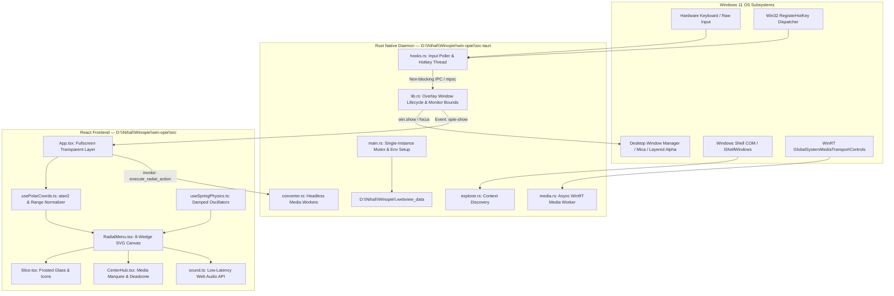

# WINEE — Technical Architecture Document

## 1. System Overview

**WINEE** is an independent Windows 11 radial productivity utility built on **Tauri v2**. It couples a high-performance, privileged Rust native backend with a fluid, hardware-accelerated React/TypeScript visual overlay.

---

## 2. Core Architectural Principles

### Principle 1: Strict Division of Responsibilities
- **Rust Backend**:
  - Owns all privileged Win32 APIs, raw input listeners, registry autostart, background worker threads, file discovery, and conversion processes.
  - Never executes long-running or blocking COM / WinRT operations inside input callback threads.
  - Enforces single-instance lifecycle using a named Windows Mutex (`Local\Winee_SingleInstance_Mutex`).
- **React Frontend**:
  - Owns presentation, 60/120fps polar coordinate calculations, spring dynamics, SVG path geometry, and low-latency audio cue playback.
  - Completely stops all animation loops and unmounts DOM nodes when the overlay is closed to achieve 0.0% idle CPU and GPU consumption.

### Principle 2: Safe Overlay Lifecycle & Multi-Monitor Geometry
1. **Monitor Discovery**:
   - Uses `MonitorFromPoint` with `MONITOR_DEFAULTTONEAREST` to find the exact monitor containing the spawn cursor coordinates $(x_0, y_0)$.
   - Retrieves monitor bounds and DPI scale factor via `GetDpiForMonitor` or `GetScaleFactorForMonitor`.
2. **Coordinate Normalization**:
   - Win32 cursor coordinates are converted from global virtual screen pixels to client-relative logical CSS pixels:
     $$\text{css}_x = \frac{x_{\text{cursor}} - x_{\text{monitor\_origin}}}{\text{DPR}}, \quad \text{css}_y = \frac{y_{\text{cursor}} - y_{\text{monitor\_origin}}}{\text{DPR}}$$
3. **Window Show / Hide Sequence**:
   - Window is created hidden (`visible: false`) with `decorations: false`, `transparent: true`, `alwaysOnTop: true`, `skipTaskbar: true`.
   - On activation: `win.show()`, `win.set_focus()`, and `win.set_always_on_top(true)` ensure the overlay appears above all normal and full-screen windows without breaking DWM alpha composition.
   - On dismissal: `win.hide()` immediately detaches the window from the composition queue.

### Principle 3: Non-Blocking Background Input Pipeline
- **Problem**: In Windows 11, `Alt + Space` is intercepted by `SC_KEYMENU` (system menu), returning `ERROR_HOTKEY_ALREADY_REGISTERED` (1409). Low-level hooks (`WH_KEYBOARD_LL`) drop if callbacks exceed Windows timeout.
- **Solution**:
  - Hardware polling thread running `GetAsyncKeyState` at 120Hz (consuming $< 0.01\%$ CPU).
  - Complemented by official `RegisterHotKey` for alternative customizable shortcuts (`Ctrl + Space`, `Alt + O`, `Ctrl + Alt + Space`).
  - The input thread never blocks; upon detecting a trigger, it sends a lightweight message to the window management worker.

### Principle 4: Strict D: Drive Storage Isolation
- To satisfy user constraints and eliminate WebView2 `0x800700AA` locks:
  - WebView2 profile path is explicitly configured to `D:\Nihal\Winopie\.webview_data`.
  - Cargo target directory: `D:\Nihal\Winopie\target`.
  - PNPM global store: `D:\.pnpm-store`.
  - Rust toolchain: `D:\.cargo` and `D:\.rustup`.
